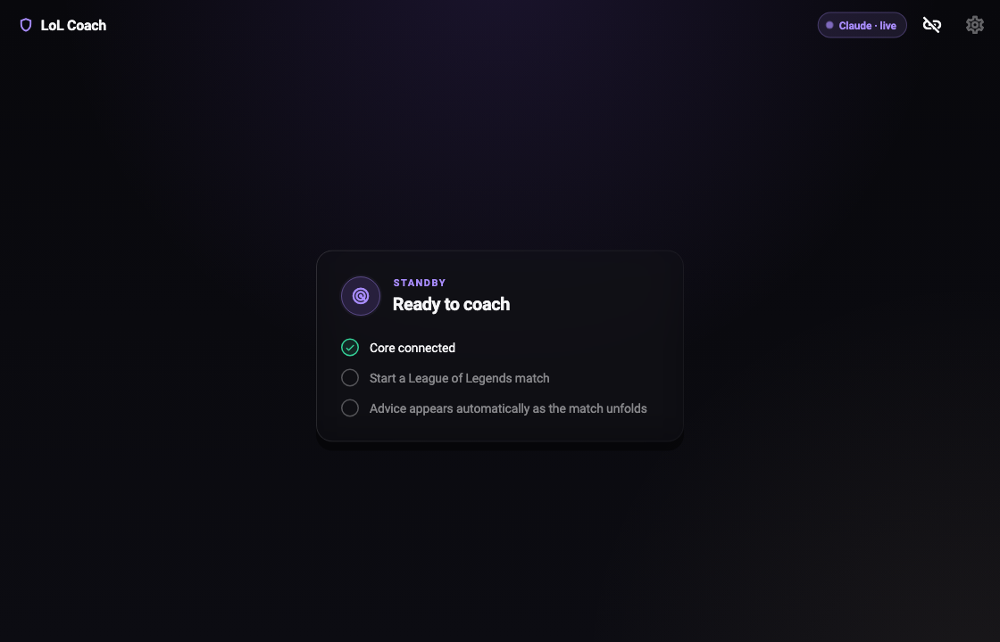
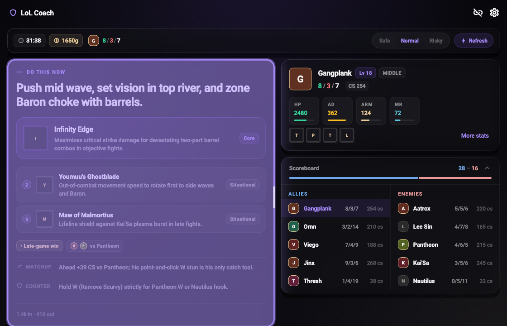

# LoL Coach

[](https://github.com/NexusHero/LOLRecommender/actions/workflows/ci.yml)
[](LICENSE)
[](https://flutter.dev)
[](https://nodejs.org)
[](https://www.typescriptlang.org)

> **A League of Legends training system: post-game review, rank benchmarks, 5-game goals and a pre-lane briefing — runs on your machine, Riot-policy compliant.**

| Off-game (standby radar) | In-game (live HUD) |
|---|---|
|  |  |

*Screenshots are from 2026-10, before the training-system rework; the live view no longer shows "do this now" advice or enemy cooldowns.*

LoL Coach is built for players who want to climb and for high-elo players who want hard numbers. A local Node.js core reads your live game (Riot Live Client API) and your ranked history (Riot API), computes the review metrics, and streams everything over WebSocket to a Flutter desktop app with an esports-HUD look. An LLM of your choice (Claude, OpenAI or Gemini) writes the texts — **every number is computed by code, never by the model.**

---

## Why LoL Coach?

| | LoL Coach | Stat sites | Overlay apps |
| --- | --- | --- | --- |
| Review of *your* games with lane diffs at 10/15 min | ✅ | partial | partial |
| Benchmarks of the next rank and Master+ for your role | ✅ (self-collected) | ✅ | ❌ |
| Training goal per 5-game block, checked automatically | ✅ | ❌ | ❌ |
| Matchup briefing from your own history | ✅ | ❌ | partial |
| Ask questions about your match history | ✅ | ❌ | ❌ |
| Runs **locally**, your data stays on your PC | ✅ | ❌ | partial |
| Bring your own LLM key | ✅ | ❌ | ❌ |
| Open source, no account | ✅ | ❌ | ❌ |

---

## Quick start

```bash
# 1. Core (run on the same PC as League)
cd core && npm install && npm run dev

# 2. Desktop app (macOS / Windows / Linux)
cd app && flutter pub get && flutter run
```

1. Put a Riot API key into `core/.env` (`RIOT_API_KEY=RGAPI-…`, see [Riot API key](#riot-api-key)).
2. In the app's **Settings** enter your Summoner Name, your **Riot ID** (`Name#TAG`) and region, and optionally an LLM provider and key.
3. Open **Analysis** from the top bar: your last 20 Ranked Solo/Duo games load within seconds.

---

## What it does

### Analysis board (after the game)
- **Post-game review** of every Ranked Solo/Duo game, fetched automatically shortly after the game ends: CS and CS difference at 10:00, deaths before 14:00 with map zone and killer, gold and XP difference at 15:00, objective presence.
- **Rank benchmarks you collect yourself** — in the background the core samples ranked games of the tier above yours and of Master, Grandmaster and Challenger for your main role, stores only averages and histograms, and re-collects every patch.
- **Standing badges** such as "Top 32% · EMERALD" per metric, plus tier badge, streak and last-10 form.
- **Training goal** — one goal per block of 5 games, picked from the metric with the largest gap to the next tier. Achieved at 4 of 5 games, otherwise the block repeats.
- **Trend chart** over your last 20 games with the next-tier benchmark as a dashed line; tap for exact values.
- **Pro depth** (collapsible): minute-by-minute gold/XP/CS difference vs. your lane opponent with early-death and objective markers, matchup table, first core item and shop visits with item icons.
- **AI texts** (with a provider): a short review per new game, the goal sentence, a summary of your backfilled games, answers to questions about your history ("Why do I lose lane against Zed?"), and one matchup insight per game saved to the local matchup memory.

### Briefing (game start)
- For your lane matchup, up to three lines for the first four minutes: how trades usually go and the opponent's most dangerous spike (LLM, phrased as facts), and the numbers of your last reviewed game in this exact matchup plus your saved note.

### Live HUD (in game)
- Objective countdowns (Dragon, Elder, Voidgrubs, Rift Herald, Baron) with current-season timings, own unspent gold, the next item to buy, and the LLM build plan.
- **Review markers** — press **F1** or type "Marker: bad trade"; the moment shows up next to the game in the review.
- Lane matchup chip, 5v5 scoreboard and champion stat gauges.

### What it deliberately does not do
Riot's third-party policy forbids tools that track enemy cooldowns, raise power-spike or gank alarms, or dictate decisions in game. LoL Coach therefore shows **no** enemy ability or summoner-spell timers, no "do this now" instructions and no screen or minimap reading. Positions, waves and vision are only analysed after the game, from Riot's match timeline.

---

## Architecture

```
┌──────────────────────────────────────────────────────────────┐
│                      Your PC (in-game)                        │
│                                                               │
│  LoL Client ──► Live Client API (port 2999)                   │
│  Riot API (account, league, match-v5 + timeline)              │
│                         │                                     │
│                         ▼                                     │
│              Node.js Core (TypeScript)                        │
│     ┌──────────────────────────────────────────────┐          │
│     │ Poller → Parser → EventDetector              │          │
│     │ RecommendationEngine + Cache + LLM provider  │          │
│     │ AnalysisService: sync, review, goals, AI     │          │
│     │ BenchmarkAggregator (background, per patch)  │          │
│     │ Briefing · Vector matchup memory             │          │
│     │ WebSocket server (127.0.0.1:8765)            │          │
│     └──────────────────────────────────────────────┘          │
└──────────────────────────────────────────────────────────────┘
                         │  WebSocket
                         ▼
              ┌──────────────────────────┐
              │  Flutter app             │
              │  Live HUD + briefing     │
              │  Analysis board          │
              │  Settings & connection   │
              └──────────────────────────┘
```

| Component | Tech |
|-----------|------|
| Core | Node.js 18+, TypeScript, Zod, ws, tsyringe (DI), @anthropic-ai/sdk, openai, @google/genai |
| Desktop app | Flutter 3.50, Dart, `material_ui`, flutter_riverpod, web_socket_channel, flutter_secure_storage, shared_preferences |
| Tests | Jest + ts-jest (core), flutter_test incl. golden tests (app) |

> **Architecture documentation:** a full [arc42 architecture document](docs/architecture.md) covers the building blocks, runtime scenarios, and decisions. Diagrams are authored in **PlantUML** (`docs/umls/*.puml`, rendered to `*.svg`).

---

## Prerequisites

- Node.js 18+
- Flutter SDK 3.50 (CI and release builds are pinned to 3.50.0)
- League of Legends installed (the core reads the local Live Client API)
- A Riot API key for the review and benchmarks

---

## Setup

### 1. Core

```bash
cd core
npm install
cp .env.example .env   # then set RIOT_API_KEY (and optionally ANTHROPIC_API_KEY)
```

Start the core:
```bash
npm run dev        # development (watch mode)
npm start          # production (requires npm run build first)
```

### Riot API key

Get a key at [developer.riotgames.com](https://developer.riotgames.com) and set `RIOT_API_KEY` in `core/.env`.

- **Development keys expire every 24 hours.** Replace the value in `core/.env` and press **Refresh** in the Analysis screen — the core re-reads the key on every sync, no restart needed. While the key is invalid the board shows a warning and benchmark collection pauses.
- For daily use register a **personal key** (does not expire, same rate limits).
- All Riot calls go through a rate limiter (20 per second, 100 per two minutes).

### 2. Flutter app

```bash
cd app
flutter pub get
flutter run
```

In **Settings** configure:
- Summoner Name, **Riot ID** (`Name#TAG`) and **region**
- Core IP and port (default `127.0.0.1:8765`)
- LLM provider (None, Claude, OpenAI or Gemini) and API key

Settings are stored locally; API keys in the system keychain.

---

## How it works

**Live game**
1. **Polling** — the core polls `https://127.0.0.1:2999/liveclientdata/allgamedata` every second.
2. **Event detection** — `EventDetector` compares snapshots and emits `GAME_STARTED`, `ITEM_PURCHASED`, `PLAYER_DIED`, `HIGH_GOLD_REACHED`.
3. **Item advice** — on these events `RecommendationEngine` asks the LLM for build advice (cached per game state); returned item ids are validated against Data Dragon.
4. **Briefing** — on `GAME_STARTED` the `AnalysisService` builds the matchup briefing and broadcasts `MATCHUP_BRIEFING`.

**After the game**
5. **Sync** — when the game ends the core waits until Riot publishes the match, then fetches match and timeline (`riotApi.ts`).
6. **Metrics** — `matchMetrics.ts` computes the review from the timeline frames and events; remakes are skipped.
7. **Goals** — `goals.ts` checks the current 5-game block and picks the next goal from the next-tier benchmark (absolute CS@10 and gold@15, because lane differences average to zero over a rank).
8. **Benchmarks** — `BenchmarkAggregator` samples ladder players' recent games in the background whenever no game runs, and resumes after restarts.
9. **Broadcast** — `ANALYSIS_UPDATE` carries the whole board; `ASK_ANALYSIS` / `ANALYSIS_ANSWER` handle questions.

**Data and security**
- Your reviewed games, goals and benchmark aggregates live in `~/.lolcoach/analysis`; of other players only averages and histograms are stored.
- The core binds to `127.0.0.1` and verifies every WebSocket upgrade with a secret auto-generated at `~/.lolcoach/.secret`.
- An optional session token budget caps LLM input tokens (`LLM_BUDGET_EXCEEDED`).

---

## Project structure

```
LOLRecommender/
├── core/                         # Backend (Node.js/TypeScript)
│   └── src/
│       ├── poller.ts · parser.ts · eventDetector.ts   # live game input
│       ├── recommendationEngine.ts · llmProvider.ts · promptBuilder.ts
│       ├── macroTracker.ts       # objective timers, informational alerts
│       ├── tacticalCommandService.ts  # coach commands, review markers
│       ├── riotApi.ts            # Riot API client + rate limiter
│       ├── matchMetrics.ts       # review metrics from match + timeline
│       ├── analysisService.ts    # sync, goals, AI texts, briefing
│       ├── benchmarkAggregator.ts# rank benchmarks + histograms
│       ├── goals.ts · briefing.ts · analysisStore.ts
│       ├── analysisTypes.ts      # contract shared with the app
│       ├── orchestrator.ts · messageRouter.ts · wsServer.ts · index.ts
│       └── __tests__/            # Jest tests, incl. a real anonymised match fixture
│
├── app/                          # Flutter app (esports HUD)
│   └── lib/
│       ├── screens/              # home, analysis, settings
│       ├── widgets/              # live HUD, matchup briefing card
│       │   └── analysis/         # board: header, goal, tiles, trend, matches, pro depth
│       ├── models/ · services/ · theme/ · utils/
│       └── providers.dart
│
├── skills/                       # Agent skills
└── deployment/                   # Build & packaging scripts
```

---

## Running tests

### All-in-one script (`test.sh`)

```bash
./test.sh                    # core + app (goldens excluded)
./test.sh --coverage         # core tests with coverage report
./test.sh --goldens          # include app golden pixel tests
./test.sh --update-goldens   # regenerate golden baselines, then run all
./test.sh --core-only        # skip app
./test.sh --app-only         # skip core
./test.sh --watch            # jest watch mode (app skipped)
```


#### Mutation testing (Stryker)

```bash
cd core
npx stryker run
# Report: core/reports/mutation/report.html
```

### Flutter only

```bash
cd app
flutter test                                              # unit + widget tests
flutter test --update-goldens test/widgets/recommendation_panel_golden_test.dart
                                                          # regenerate golden baselines
```

> **Golden tests** compare against baselines in `app/test/widgets/goldens/` and are rendered with the pinned Flutter version (3.50). CI skips them; run them locally with `./test.sh --goldens`.

---

## AI-assisted development

This project is set up with agent skills to enforce architecture and quality rules for all AI assistants.

### Project skills (slash commands)

Skills live in `.claude/commands/` and are committed to the repo, so every contributor gets them automatically.

| Skill | What it does |
|-------|-------------|
| `/test` | Runs the full suite — `flutter analyze` → app tests → core tests. Accepts the same flags as `test.sh` (e.g. `/test --app-only`). |

### Pre-commit hook

The hook runs `flutter analyze` before every commit that touches `app/` (~4 s). It mirrors the CI analyze step so lint errors never reach the pipeline.

After a fresh clone, install it once:

```bash
cp scripts/hooks/pre-commit .git/hooks/pre-commit
chmod +x .git/hooks/pre-commit
```

> The hook is intentionally lightweight. It only runs analyze, not the full test suite, so commits stay fast.

### Conventions (auto-applied by AI assistants)

All rules live in the [`lolcoach-agents` skill](skills/lolcoach-agents/SKILL.md) under **Conventions**. AI assistants apply them without being asked.

| Rule | Detail |
|------|--------|
| **Commit messages** | [Conventional Commits](https://www.conventionalcommits.org) in English — `type(scope): summary` |
| **Test names** | Microsoft naming — `Subject_StateUnderTest_ExpectedBehaviour` |
| **Test structure** | AAA pattern — Arrange / Act / Assert with a blank line between each phase |

### Agent context skills

| File | Purpose |
|------|---------|
| [`lolcoach-agents`](skills/lolcoach-agents/SKILL.md) | Vendor-neutral context — architecture, conventions, quality gates. Read by all AI assistants. |
| [`lolcoach-claude`](skills/lolcoach-claude/SKILL.md) | Claude-specific settings — model defaults, response style, commit rules. |
| [`lolcoach-gemini`](skills/lolcoach-gemini/SKILL.md) | Gemini-specific overrides. |

---

## License

[MIT](LICENSE) © 2025 Suhay Sevinc
